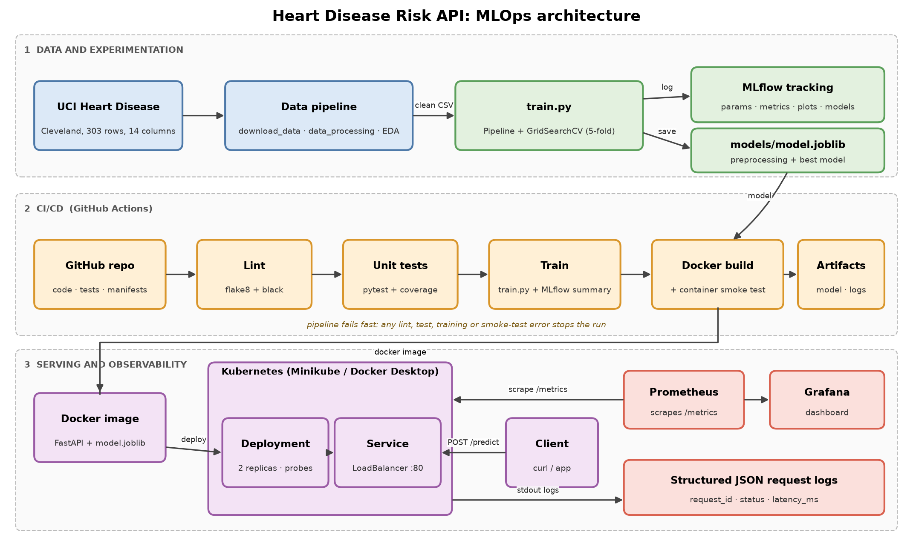

# Heart Disease Risk API: an end-to-end MLOps project

Predicts the presence of heart disease from 13 clinical features (UCI Heart Disease, Cleveland subset) and serves
the model as a containerised, monitored REST API with CI/CD, experiment tracking and Kubernetes deployment.

> Educational project. Not a medical device and not for clinical use.

**Repository:** `https://github.com/Sudarsas2410/ml_ops` &nbsp;|&nbsp; **CI:** see the *Actions* tab



## Contents

1. [What is in the repo (mapped to the assignment)](#1-what-is-in-the-repo)
2. [Quick start](#2-quick-start)
3. [Data and EDA](#3-data-and-eda)
4. [Modelling and experiment tracking](#4-modelling-and-experiment-tracking)
5. [API](#5-api)
6. [Docker](#6-docker)
7. [Kubernetes deployment](#7-kubernetes-deployment)
8. [Monitoring and logging](#8-monitoring-and-logging)
9. [CI/CD](#9-cicd)
10. [Tests](#10-tests)
11. [Design decisions](#11-design-decisions)
12. [Project layout](#12-project-layout)

## 1. What is in the repo

| # | Assignment task | Where to look |
|---|---|---|
| 1 | Data acquisition and EDA | `src/download_data.py`, `src/data_processing.py`, `src/eda.py`, `notebooks/01_eda.ipynb`, `reports/figures/` |
| 2 | Feature engineering and model development | `src/data_processing.py` (`build_preprocessor`), `src/train.py`, `notebooks/02_model_development.ipynb` |
| 3 | Experiment tracking | MLflow in `src/train.py`; summary in `reports/experiment_summary.md` |
| 4 | Packaging and reproducibility | `models/model.joblib` (preprocessing + model in one `Pipeline`), `models/metrics.json`, pinned `requirements*.txt` |
| 5 | CI/CD and automated testing | `.github/workflows/ci.yml`, `tests/` (pytest) |
| 6 | Containerisation | `Dockerfile`, `.dockerignore`, `scripts/smoke_test.sh` |
| 7 | Production deployment | `k8s/` (Deployment, Service, optional Ingress and HPA) |
| 8 | Monitoring and logging | `api/main.py` (JSON logs, `/metrics`), `docker-compose.yml`, `monitoring/` (Prometheus + Grafana) |
| 9 | Documentation and reporting | this README, `report/REPORT.md`, `report/architecture.png` |

## 2. Quick start

Requires Python 3.11+ (developed on 3.13). Docker and a local Kubernetes (Minikube or Docker Desktop) are only needed
for sections 6-8.

```bash
git clone https://github.com/Sudarsas2410/ml_ops.git && cd ml_ops
python -m venv .venv
source .venv/bin/activate            # Windows PowerShell: .venv\Scripts\Activate.ps1
pip install -r requirements-dev.txt

python -m src.download_data          # dataset -> data/raw/
python -m src.data_processing        # cleaned CSV -> data/processed/heart_clean.csv
python -m src.eda                    # figures -> reports/figures/
python -m src.train                  # trains 3 models, logs to MLflow, saves models/model.joblib
python scripts/mlflow_summary.py     # reports/experiment_summary.md
pytest                               # unit tests
uvicorn api.main:app --port 8000     # serve at http://localhost:8000/docs
```

Every command above is also a `make` target (`make help`). Everything runs from a clean checkout using only the
requirements files.

## 3. Data and EDA

* **Source:** UCI Machine Learning Repository, *Heart Disease*, Cleveland file `processed.cleveland.data`
  (303 rows, 13 features + `num`). `src/download_data.py` downloads it (falling back to the `ucimlrepo` package).
  If you are offline, save the file manually to `data/raw/processed.cleveland.data`.
* **Cleaning** (`src/data_processing.py`): `?` parsed as missing; duplicates dropped; the 0-4 diagnosis `num`
  binarised to `target = (num > 0)`; implausible values masked; remaining gaps imputed (median for continuous, mode for
  categorical). The cleaned file is committed at `data/processed/heart_clean.csv`.
* **EDA** (`src/eda.py`, `notebooks/01_eda.ipynb`): missing values, class balance, histograms and box plots by class,
  categorical counts by class, correlation heatmap, correlation with the target.

## 4. Modelling and experiment tracking

* **Features:** a single `ColumnTransformer` inside the model `Pipeline`. Continuous features are median-imputed and
  standardised. Categorical codes are mode-imputed and one-hot encoded (`handle_unknown="ignore"`). Imputation and
  scaling are fitted inside every CV fold, so there is no leakage.
* **Models:** Logistic Regression, Random Forest and Gradient Boosting (an extra non-linear baseline).
* **Protocol:** stratified 80/20 hold-out split. `GridSearchCV` with 5-fold stratified CV on the training split,
  refit on ROC-AUC. The winner is chosen on **CV ROC-AUC only**. The hold-out set is used once for the reported estimate.
* **Metrics:** accuracy, precision, recall, F1, ROC-AUC (CV mean ± std and hold-out).
* **MLflow:** one parent run (`model-comparison`) with one nested run per model, logging parameters, CV and test
  metrics, ROC curve, confusion matrix, feature importance, the full `cv_results_` table, a classification report and
  the fitted pipeline (with signature and input example). The best model is also added to the model registry.

```bash
mlflow ui --backend-store-uri sqlite:///mlflow.db     # http://localhost:5000
```

Results of the latest run are in [`reports/experiment_summary.md`](reports/experiment_summary.md) and
`models/metrics.json`.

## 5. API

| Method | Path | Purpose |
|---|---|---|
| POST | `/predict` | JSON patient record in; prediction, label, confidence out |
| GET | `/health` | liveness probe |
| GET | `/ready` | readiness probe (503 until the model is loaded) |
| GET | `/model-info` | model name, version, training metrics, feature list |
| GET | `/metrics` | Prometheus metrics |
| GET | `/docs` | interactive OpenAPI documentation |

```bash
curl -s -X POST http://localhost:8000/predict -H "Content-Type: application/json" -d @scripts/sample_input.json
```

```json
{"prediction": 1, "label": "heart disease", "confidence": 0.80, "probability_disease": 0.80, "model_version": "1.0.0"}
```

`confidence` is the probability of the predicted class; `probability_disease` is always P(disease).
Inputs are validated (ranges and allowed category codes): invalid payloads get HTTP 422 with a field-level message.

| Field | Meaning |
|---|---|
| `age` | years (1-120) |
| `sex` | 1 male, 0 female |
| `cp` | chest pain type: 1 typical angina, 2 atypical, 3 non-anginal, 4 asymptomatic |
| `trestbps` | resting blood pressure, mm Hg (50-260) |
| `chol` | serum cholesterol, mg/dl (80-700) |
| `fbs` | fasting blood sugar > 120 mg/dl (1/0) |
| `restecg` | resting ECG: 0 normal, 1 ST-T abnormality, 2 LV hypertrophy |
| `thalach` | maximum heart rate achieved (50-250) |
| `exang` | exercise-induced angina (1/0) |
| `oldpeak` | ST depression induced by exercise (0-10) |
| `slope` | slope of peak exercise ST segment: 1 up, 2 flat, 3 down |
| `ca` | major vessels coloured by fluoroscopy (0-3) |
| `thal` | 3 normal, 6 fixed defect, 7 reversible defect |

## 6. Docker

The image contains only inference dependencies (`requirements-serve.txt`), runs as a non-root user and has a health
check. Train first so that `models/model.joblib` exists.

```bash
docker build -t heart-api:1.0.0 .
docker run --rm -p 8000:8000 heart-api:1.0.0
bash scripts/smoke_test.sh http://localhost:8000      # 5 checks, non-zero exit on failure
```

## 7. Kubernetes deployment

Manifests in `k8s/`: namespace, Deployment (2 replicas, startup/readiness/liveness probes, resource limits,
non-root, read-only root filesystem), and a `LoadBalancer` Service. `k8s/optional/` holds an Ingress and an HPA.

**Minikube**

```bash
minikube start --driver=docker
docker build -t heart-api:1.0.0 .
minikube image load heart-api:1.0.0
kubectl apply -k k8s/
kubectl -n heart-mlops rollout status deployment/heart-api
kubectl -n heart-mlops get pods,svc
minikube service heart-api -n heart-mlops --url        # prints the URL; keep this terminal open
bash scripts/smoke_test.sh <that-url>
```

(`minikube tunnel` in another terminal gives the Service an EXTERNAL-IP instead.)

**Docker Desktop:** enable *Settings → Kubernetes*, run `kubectl config use-context docker-desktop`, build the image
and `kubectl apply -k k8s/`. The LoadBalancer is then reachable at `http://localhost/`.

**Ingress (optional):** `minikube addons enable ingress && kubectl apply -f k8s/optional/ingress.yaml`, then
`curl -H "Host: heart-api.local" http://$(minikube ip)/health`.

**Public cloud (GKE/EKS/AKS):** push the image to a registry, change `image:` in `k8s/deployment.yaml`, set
`imagePullPolicy: Always`, and apply. The Service type `LoadBalancer` provisions a public IP.

## 8. Monitoring and logging

* **Logs:** every request is logged to stdout as one JSON line (`request_id`, method, path, status, `latency_ms`,
  client), plus a `prediction` event with the class and confidence. Set `LOG_FILE` to also write a file.
  `docker logs <container>` or `kubectl -n heart-mlops logs deploy/heart-api` shows them.
* **Metrics** at `/metrics`: `http_requests_total{method,handler,status}`, `http_request_duration_seconds`
  (histogram), `http_requests_in_progress`, `heart_predictions_total{prediction}`,
  `heart_prediction_confidence` (histogram), `heart_model_info`, plus process metrics. Unknown paths are bucketed as
  `unmatched` to keep label cardinality bounded.
* **Prometheus + Grafana:**

```bash
docker compose up --build -d
python scripts/generate_traffic.py --requests 300      # fill the dashboard
```

| Service | URL |
|---|---|
| API | http://localhost:8000/docs |
| Prometheus | http://localhost:9090 (Status → Targets) |
| Grafana | http://localhost:3000 (admin / admin) → dashboard **Heart Disease API** |

The dashboard (provisioned from `monitoring/grafana/provisioning/dashboards/heart-api.json`) shows uptime, total
requests, predictions by class, error count, request rate per endpoint, p50/p95/p99 latency, status codes, mean
confidence and in-flight requests. To monitor the Kubernetes deployment instead, run
`kubectl -n heart-mlops port-forward svc/heart-api 8080:80` and point the Prometheus target at
`host.docker.internal:8080`.

## 9. CI/CD

`.github/workflows/ci.yml` runs on every push and pull request, as four chained jobs (each `needs` the previous):

1. **lint**: `flake8` and `black --check`.
2. **test**: `pytest` with coverage (fails under 85 %); uploads JUnit and coverage XML; writes a summary.
3. **train**: downloads data, cleans, runs EDA, trains and tracks, writes the MLflow summary to the job summary, uploads
   the model, metrics, figures and MLflow store as artifacts.
4. **docker**: builds the image with the model trained in the same run, starts the container, runs the smoke test and
   uploads the container logs.

Any failing step stops the pipeline with a non-zero exit code and a clear log, as required.

## 10. Tests

`pytest` runs 64 offline tests on synthetic data (`tests/helpers.py` mimics the UCI schema; it is never used for
reported results). Coverage is about 94 % of `src/` and `api/`.

* **Data:** parsing of `?`, cleaning rules, imputation, duplicate and implausible-value handling, schema validation,
  preprocessor output (shape, scaling, unseen and missing values).
* **Model:** probability validity, prediction schema, save/load round trip, reproducibility with a fixed seed, metric
  correctness, and a full training run that is checked against the MLflow store (parent and child runs, metrics,
  artifacts).
* **API:** happy path, 10 invalid-input cases, missing model (503), request IDs, Prometheus metrics, bounded label
  cardinality and JSON log lines.
* **Scripts:** download fallbacks, EDA outputs, and the train and predict CLIs.

## 11. Design decisions

* **One pipeline object** holds preprocessing and model, so training, tests, API and notebooks use identical logic.
* **ROC-AUC for selection**: threshold-independent and stable on a small, mildly imbalanced set. Recall is reported
  because a missed case costs more than a false alarm.
* **Selection on CV, reporting on hold-out**: the test set is not used for any decision, so it gives an honest estimate.
  With only 303 rows the estimates are noisy; compare differences against the CV standard deviation.
* **Categorical codes are one-hot encoded** because `cp`, `thal` and `slope` are labels, not ordered quantities.
* **Cleaning vs. pipeline imputation:** the saved CSV is imputed for convenience, and the pipeline imputes again inside
  each fold. Only 6 values are affected (4 in `ca`, 2 in `thal`).
* **Custom Prometheus metrics** instead of a wrapper library: full control over names and label cardinality, and one
  fewer dependency in the image.
* **Pinned dependencies** and a slim serving requirements file keep the image small and the pickled pipeline
  loadable by exactly the versions that trained it.

**Limitations:** single-centre dataset of 303 patients; no external validation; the model is not calibrated for clinical
use; the API has no authentication (add an API gateway or auth middleware before exposing it publicly).

## 12. Project layout

```
.
├── .github/workflows/ci.yml       CI/CD pipeline
├── api/main.py                    FastAPI service (validation, JSON logs, Prometheus metrics)
├── data/{raw,processed}/          dataset and cleaned CSV
├── k8s/                           Kubernetes manifests (+ optional/ingress, hpa)
├── models/                        model.joblib and metrics.json
├── monitoring/                    Prometheus config, Grafana provisioning and dashboard
├── notebooks/                     01_eda, 02_model_development, 03_inference
├── report/                        REPORT.md, architecture.png
├── reports/                       figures/, eda_summary.json, experiment_summary.md
├── screenshots/                   evidence for the report
├── scripts/                       smoke test, traffic generator, MLflow summary, notebook and diagram builders
├── src/                           config, download_data, data_processing, eda, train, predict
├── tests/                         pytest suite
├── Dockerfile  docker-compose.yml  Makefile
└── requirements.txt  requirements-serve.txt  requirements-dev.txt
```
