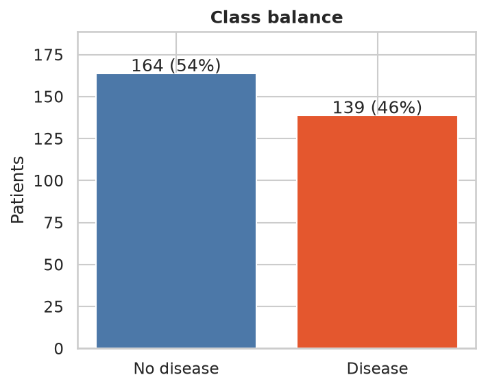
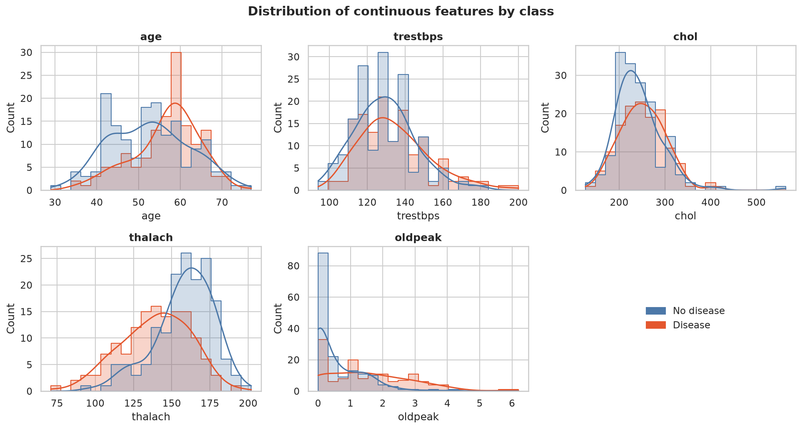
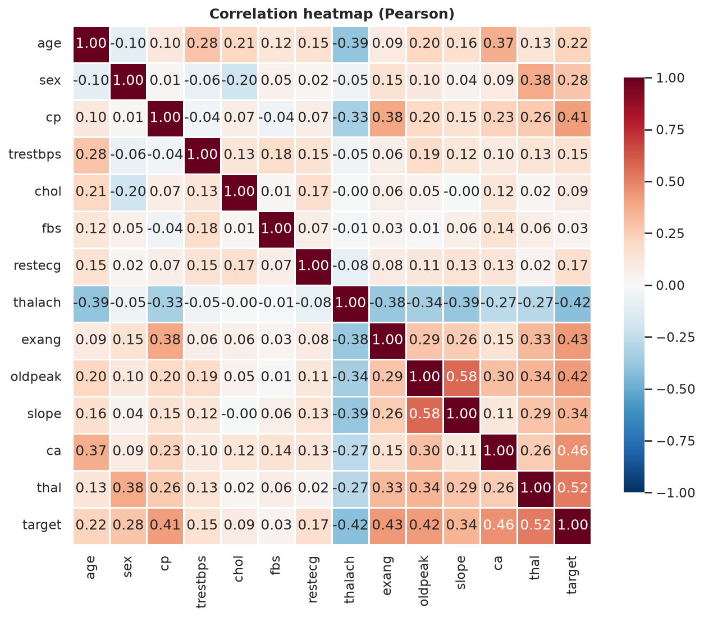
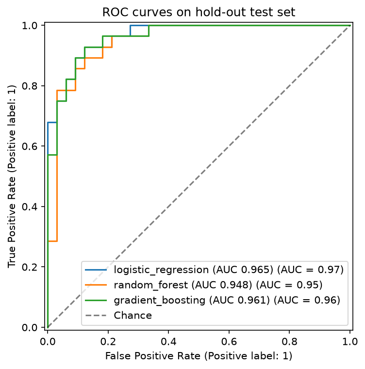
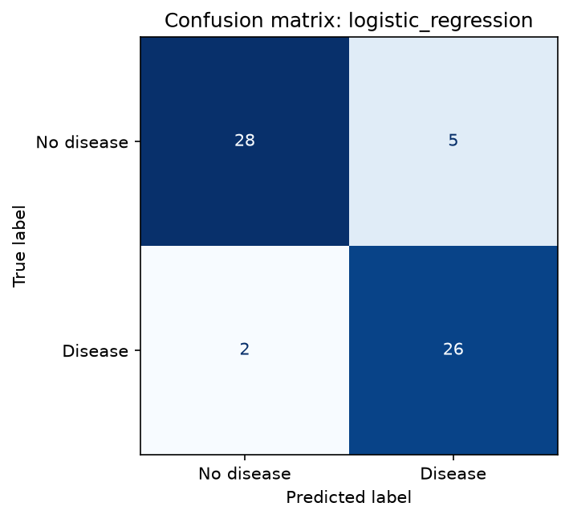

# 1. Introduction

**Problem.** Predict the presence of heart disease from 13 routine clinical measurements, and deliver the model as a
reproducible, tested, containerised and monitored API.

**Dataset.** UCI Heart Disease, Cleveland subset: 303 patients, 13 features, diagnosis `num` (0-4) binarised to
presence/absence. Binarising the original 0–4 diagnosis makes the task a binary classification problem; it does not preserve disease severity.

**Repository:** https://github.com/Sudarsas2410/ml_ops  
**Deployed API / access instructions:** Local Minikube access via kubectl port-forward; see Section 8  
**Video:** Not yet recorded; see `docs/VIDEO_SCRIPT.md`.

# 2. Setup and installation

```bash
git clone https://github.com/Sudarsas2410/ml_ops && cd ml_ops
python -m venv .venv && source .venv/bin/activate
pip install -r requirements-dev.txt
python -m src.download_data && python -m src.data_processing
python -m src.eda && python -m src.train
pytest
uvicorn api.main:app --port 8000
```

Development environment: Python 3.12.9 on Rocky Linux 9.5 (x86_64), Docker Engine 28.0.1, Minikube 1.35.0 with Kubernetes 1.32.0. The API image uses `python:3.13-slim`.
All scripts run from a clean checkout using `requirements.txt`; versions are pinned.

# 3. Data acquisition, cleaning and EDA

## 3.1 Acquisition and cleaning

`src/download_data.py` downloads `processed.cleveland.data` from UCI (with a `ucimlrepo` fallback).

| Issue found | Treatment | Reason |
|---|---|---|
| `?` in `ca` (4 rows) and `thal` (2 rows) | parsed as missing, mode imputation | categorical codes |
| `num` takes values 0-4 | `target = (num > 0)` | task requires presence/absence |
| Duplicate rows | 0 in the cleaned dataset | No duplicate rows were found after cleaning. |

The scikit-learn pipeline repeats imputation and scaling inside each cross-validation fold, so nothing from a
validation fold leaks into training.

## 3.2 Exploratory analysis

{ width=55% }

**Class balance:** 164 patients (54.1%) have target 0 and 139 (45.9%) have target 1. Both classes are represented, so accuracy alone is insufficient; ROC-AUC and disease-class recall are also reported.

{ width=95% }

{ width=75% }

The class-balance figure shows 164 records in class 0 and 139 in class 1, so neither class dominates the dataset. The target-correlation figure shows the largest positive associations for `thal` (0.522), `ca` (0.460), `exang` (0.432) and `oldpeak` (0.425), while `thalach` is negatively associated (-0.417). These are associations, not causal effects. The raw data contain missing markers in `ca` (4 rows) and `thal` (2 rows); the cleaned dataset has no missing values and no duplicate rows. Histograms and boxplots support inspection of feature distributions, but this analysis did not establish a separate outlier-removal rule. Imputation, scaling and encoding remain inside the model pipeline to avoid fitting preprocessing on validation data.

# 4. Feature engineering and modelling choices

* Continuous features (`age, trestbps, chol, thalach, oldpeak`): median imputation, standardisation.
* Categorical features (`sex, cp, fbs, restecg, exang, slope, ca, thal`): mode imputation, one-hot encoding with
  `handle_unknown="ignore"` so unseen codes cannot break serving.
* All steps live in one `ColumnTransformer` inside the model `Pipeline` (`src/data_processing.py`).

**Models and tuning.** Logistic Regression, Random Forest and Gradient Boosting, each tuned with `GridSearchCV`
(5-fold stratified CV, refit on ROC-AUC). Stratified 80/20 hold-out split; the model is chosen on CV ROC-AUC only.

| Model | Grid searched |
|---|---|
| Logistic Regression | `C` in {0.01, 0.1, 1, 10}; `class_weight` in {None, balanced} |
| Random Forest | `n_estimators` {100, 300}; `max_depth` {None, 4, 8}; `min_samples_leaf` {1, 3, 5} |
| Gradient Boosting | `n_estimators` {100, 200}; `learning_rate` {0.05, 0.1}; `max_depth` {2, 3} |

**Why these metrics.** ROC-AUC measures ranking discrimination across classification thresholds and is the selection metric used with stratified cross-validation. Recall is included because false negatives matter in a disease-screening context. This experimental model is not a clinical diagnostic tool.

## 4.1 Results

The following table summarises the hold-out results; mean cross-validation ROC-AUC is shown separately to make the selection criterion explicit.

| Model | CV ROC-AUC | Test accuracy | Test precision | Test recall | Test ROC-AUC |
|---|---|---|---|---|---|
| Logistic Regression | 0.903 ± 0.017 | 0.885 | 0.839 | 0.929 | 0.965 |
| Random Forest | 0.902 ± 0.033 | 0.852 | 0.806 | 0.893 | 0.948 |
| Gradient Boosting | 0.874 ± 0.025 | 0.902 | 0.867 | 0.929 | 0.961 |

{ width=65% }

{ width=45% }

**Selected model: Logistic Regression.** It was selected by mean five-fold cross-validation ROC-AUC (0.903 ± 0.017). Random Forest was very close at 0.902 ± 0.033, so the small difference does not establish a meaningful superiority. On the hold-out set, Logistic Regression achieved ROC-AUC 0.965 and recall 0.929; Gradient Boosting had higher accuracy (0.902 versus 0.885). This illustrates that rankings depend on the metric. The EDA associations provide context but do not, by themselves, establish model feature importance. A key limitation is the small dataset of 303 records and the absence of external validation.

# 5. Experiment tracking summary (MLflow)

Every training run logs, to a local SQLite-backed MLflow store: parameters (best hyper-parameters, split sizes, seed),
CV metrics (mean and std), hold-out metrics, fit time, plots (ROC, confusion matrix, feature importance, model
comparison), the full grid-search table, a classification report and the fitted pipeline with signature and input
example. One parent run groups the three nested model runs; the best model is registered as `heart-disease-classifier`.

**MLflow evidence:** capture the local runs table before submission; the screenshot has not yet been added.

**MLflow comparison evidence:** capture the comparison view before submission; the screenshot has not yet been added.

**MLflow artifact evidence:** capture a run's artifact view before submission; the screenshot has not yet been added.

**Experiment summary.** Six MLflow runs are present in the local tracking store. The comparison evaluated Logistic Regression, Random Forest and Gradient Boosting using seeded stratified five-fold CV and a 20% hold-out set. Logistic Regression had the highest mean CV ROC-AUC, while Gradient Boosting had the highest hold-out accuracy. This demonstrates why model selection should follow a predeclared metric rather than selecting whichever model has the best single hold-out score.

# 6. Model packaging and reproducibility

* `models/model.joblib`: the complete fitted pipeline (preprocessing + estimator); `models/metrics.json`: metrics,
  parameters, data checksum, library versions, timestamp.
* The same model is also logged to MLflow with a signature.
* Pinned `requirements.txt` (full) and `requirements-serve.txt` (inference only, identical numeric-stack versions).
* Fixed seed (42) for the split, CV and models; a test asserts identical predictions for identical seeds.

# 7. CI/CD and automated testing

**Tests.** 64 pytest tests passed with 94% overall coverage, covering data processing, model code, API behaviour and command-line workflows. Two deprecation warnings were reported; there were no test failures.


**Pipeline** (`.github/workflows/ci.yml`): lint → test → train → docker. Each stage must pass for the next to run.


**Failure behaviour.** The workflow is configured to stop when a required CI stage fails. A deliberately failing test run and its GitHub Actions screenshot have not been captured, so this report does not claim that a failure demonstration was completed.


# 8. Containerisation and deployment

## 8.1 Docker

Slim `python:3.13-slim` image, inference dependencies only, non-root user, health check, model baked in.


## 8.2 Kubernetes (Minikube v1.35.0, Kubernetes v1.32.0, Docker driver)

Deployment with 2 replicas, rolling updates, startup/readiness/liveness probes, CPU/memory requests and limits,
non-root user, read-only root filesystem; `LoadBalancer` Service on port 80.


**Access instructions:** `minikube kubectl -- -n heart-mlops port-forward service/heart-api 8080:80`, then access http://127.0.0.1:8080/ready and /predict.

# 9. Monitoring and logging

* Structured JSON logs for every request (id, path, status, latency) and every prediction (class, confidence).
* Prometheus metrics at `/metrics` (request count, latency histogram, status codes, predictions by class, confidence).
* Grafana dashboard provisioned from `monitoring/`.


**Traffic test.** `python scripts/generate_traffic.py --requests 300` completed with 283 successful responses (HTTP 200) and 17 invalid-payload responses (HTTP 422). The API metrics endpoint exposed request counters for these response classes, and the Prometheus target `heart-api` was reported as up. Exact dashboard rate and p95 latency values were not recorded, so they are not claimed here.

# 10. Architecture

{ width=100% }

The pipeline starts with downloading the Cleveland heart-disease data, then cleans and explores it before training candidate scikit-learn pipelines. Training records parameters and metrics in MLflow and saves the selected pipeline for inference. The FastAPI service loads that model and exposes health, readiness, prediction and Prometheus metrics endpoints. Docker packages the API, while Kubernetes runs two replicas with health probes and resource limits. Prometheus scrapes API metrics and Grafana provides the monitoring dashboard. Automated CI checks linting, tests, training and image building.

# 11. Conclusions, limitations and future work

The project brings together data cleaning, exploratory analysis, model comparison, MLflow experiment tracking, automated tests, Docker packaging, a local Kubernetes deployment and Prometheus metrics. The dataset contains only 303 records, and external validation has not been performed; the reported scores therefore do not establish clinical safety or generalisation to other populations. The API is a demonstration service without authentication, and a complete production drift-monitoring process has not been validated. Next steps are to evaluate the model on independent representative data, assess probability calibration and decision thresholds with qualified domain experts, and add monitored drift alerts and deployment safeguards.

# 12. References

* Detrano, R. et al. (1989). International application of a new probability algorithm for the diagnosis of coronary
  artery disease. *American Journal of Cardiology*, 64(5), 304-310.
* Dua, D. and Graff, C. UCI Machine Learning Repository: Heart Disease. https://archive.ics.uci.edu/dataset/45/heart+disease
* scikit-learn documentation: https://scikit-learn.org/stable/ (pipeline and model-selection concepts).
