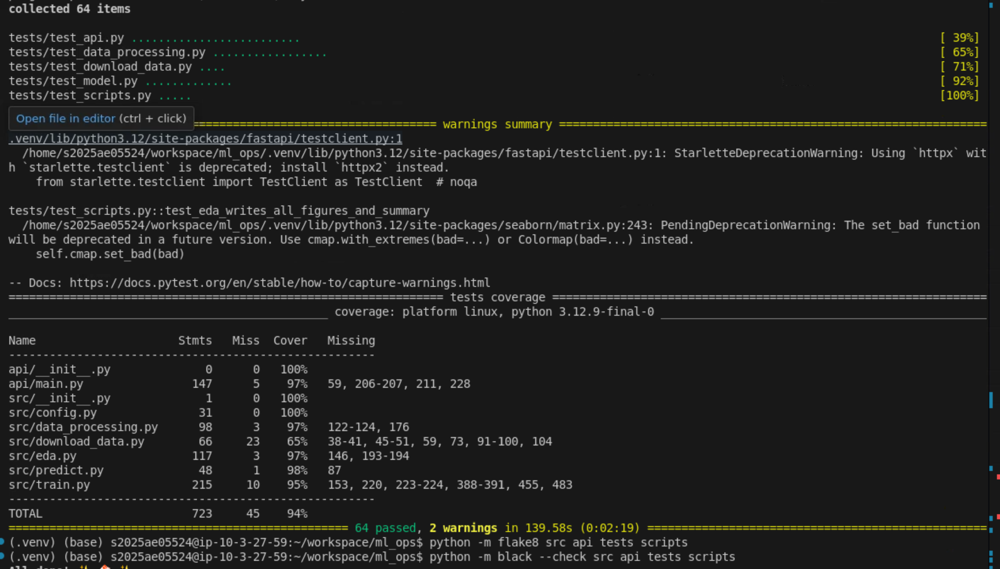

> **How to use this template.** Everything marked **[FILL]** needs your own numbers, screenshots or words. Paragraphs
> without a marker describe what the repository does and should be checked against your final code, then reworded so
> the report reflects your own understanding. Delete these instruction blocks. Target length: about 10 pages with
> figures. Build with `make report` (needs pandoc) or paste into Word and export to PDF.

# 1. Introduction

**Problem.** Predict the presence of heart disease from 13 routine clinical measurements, and deliver the model as a
reproducible, tested, containerised and monitored API.

**Dataset.** UCI Heart Disease, Cleveland subset: 303 patients, 13 features, diagnosis `num` (0-4) binarised to
presence/absence. **[FILL: one sentence on why this framing is reasonable.]**

**Repository:** [FILL: https://github.com/your-username/your-repo]  
**Deployed API / access instructions:** [FILL: URL, or "run `kubectl ... ` as in Section 8"]  
**Video:** [FILL: link or file name]

# 2. Setup and installation

```bash
git clone [FILL: repo URL] && cd [FILL: repo]
python -m venv .venv && source .venv/bin/activate
pip install -r requirements-dev.txt
python -m src.download_data && python -m src.data_processing
python -m src.eda && python -m src.train
pytest
uvicorn api.main:app --port 8000
```

Python [FILL: version used], OS [FILL], Docker [FILL: version], Kubernetes [FILL: Minikube/Docker Desktop version].
All scripts run from a clean checkout using `requirements.txt`; versions are pinned.

# 3. Data acquisition, cleaning and EDA

## 3.1 Acquisition and cleaning

`src/download_data.py` downloads `processed.cleveland.data` from UCI (with a `ucimlrepo` fallback).

| Issue found | Treatment | Reason |
|---|---|---|
| `?` in `ca` ([FILL] rows) and `thal` ([FILL] rows) | parsed as missing, mode imputation | categorical codes |
| `num` takes values 0-4 | `target = (num > 0)` | task requires presence/absence |
| duplicates / implausible values | [FILL: counts found] | avoids CV leakage; defensive checks |

The scikit-learn pipeline repeats imputation and scaling inside each cross-validation fold, so nothing from a
validation fold leaks into training.

## 3.2 Exploratory analysis

{ width=55% }

**[FILL: class counts and percentages; what this means for the choice of metrics.]**

{ width=95% }

{ width=75% }

**[FILL: 3-5 findings in your own words, each tied to a figure: which features separate the classes, any outliers,
any strongly correlated pairs, and what you changed or kept because of it.]**

# 4. Feature engineering and modelling choices

* Continuous features (`age, trestbps, chol, thalach, oldpeak`): median imputation, standardisation.
* Categorical features (`sex, cp, fbs, restecg, exang, slope, ca, thal`): mode imputation, one-hot encoding with
  `handle_unknown="ignore"` so unseen codes cannot break serving.
* All steps live in one `ColumnTransformer` inside the model `Pipeline` (`src/data_processing.py`).

**Models and tuning.** Logistic Regression, Random Forest and Gradient Boosting, each tuned with `GridSearchCV`
(5-fold stratified CV, refit on ROC-AUC). Stratified 80/20 hold-out split; the model is chosen on CV ROC-AUC only.

| Model | Grid searched |
|---|---|
| Logistic Regression | `C` in {0.01, 0.1, 1, 10}; `class_weight` in {None, balanced} |
| Random Forest | `n_estimators` {100, 300}; `max_depth` {None, 4, 8}; `min_samples_leaf` {1, 3, 5} |
| Gradient Boosting | `n_estimators` {100, 200}; `learning_rate` {0.05, 0.1}; `max_depth` {2, 3} |

**Why these metrics.** **[FILL: explain why ROC-AUC for selection and why recall matters here.]**

## 4.1 Results

**[FILL: paste the tables from `reports/experiment_summary.md`.]**

| Model | CV ROC-AUC | Test accuracy | Test precision | Test recall | Test ROC-AUC |
|---|---|---|---|---|---|
| Logistic Regression | [FILL] | [FILL] | [FILL] | [FILL] | [FILL] |
| Random Forest | [FILL] | [FILL] | [FILL] | [FILL] | [FILL] |
| Gradient Boosting | [FILL] | [FILL] | [FILL] | [FILL] | [FILL] |

{ width=65% }

{ width=45% }

**Selected model: [FILL].** **[FILL: why it won; whether the gap to the others exceeds the CV standard deviation; how
CV and hold-out agree; most important features and whether that matches the EDA; one limitation.]**

# 5. Experiment tracking summary (MLflow)

Every training run logs, to a local SQLite-backed MLflow store: parameters (best hyper-parameters, split sizes, seed),
CV metrics (mean and std), hold-out metrics, fit time, plots (ROC, confusion matrix, feature importance, model
comparison), the full grid-search table, a classification report and the fitted pipeline with signature and input
example. One parent run groups the three nested model runs; the best model is registered as `heart-disease-classifier`.

{ width=95% }

{ width=95% }

{ width=95% }

**[FILL: number of runs you executed, what you changed between runs and what you learned.]**

# 6. Model packaging and reproducibility

* `models/model.joblib`: the complete fitted pipeline (preprocessing + estimator); `models/metrics.json`: metrics,
  parameters, data checksum, library versions, timestamp.
* The same model is also logged to MLflow with a signature.
* Pinned `requirements.txt` (full) and `requirements-serve.txt` (inference only, identical numeric-stack versions).
* Fixed seed (42) for the split, CV and models; a test asserts identical predictions for identical seeds.

# 7. CI/CD and automated testing

**Tests.** [FILL: N] pytest tests, [FILL: %] coverage, covering data processing, model code, API behaviour and CLIs.

{ width=90% }

**Pipeline** (`.github/workflows/ci.yml`): lint → test → train → docker. Each stage must pass for the next to run.

{ width=95% }

{ width=80% }

**Failure behaviour.** I deliberately broke a test on branch `[FILL: branch name]` to show the pipeline fails and
stops with a clear log.

{ width=95% }

# 8. Containerisation and deployment

## 8.1 Docker

Slim `python:3.13-slim` image, inference dependencies only, non-root user, health check, model baked in.

{ width=85% }

{ width=85% }

## 8.2 Kubernetes ([FILL: Minikube / Docker Desktop / GKE...])

Deployment with 2 replicas, rolling updates, startup/readiness/liveness probes, CPU/memory requests and limits,
non-root user, read-only root filesystem; `LoadBalancer` Service on port 80.

{ width=85% }

{ width=85% }

**Access instructions:** [FILL: exact commands/URL a grader can use].

# 9. Monitoring and logging

* Structured JSON logs for every request (id, path, status, latency) and every prediction (class, confidence).
* Prometheus metrics at `/metrics` (request count, latency histogram, status codes, predictions by class, confidence).
* Grafana dashboard provisioned from `monitoring/`.

{ width=90% }

{ width=70% }

{ width=95% }

**[FILL: what the dashboard showed when you ran `generate_traffic.py` (rates, p95 latency, error panel).]**

# 10. Architecture

{ width=100% }

**[FILL: 1 paragraph walking through the diagram, left to right, in your own words.]**

# 11. Conclusions, limitations and future work

**[FILL: what worked; honest limitations (small single-centre dataset, no external validation, no auth on the API, no
drift monitoring); 2-3 concrete next steps such as model calibration, data-drift monitoring, canary deployment.]**

# 12. References

* Detrano, R. et al. (1989). International application of a new probability algorithm for the diagnosis of coronary
  artery disease. *American Journal of Cardiology*, 64(5), 304-310.
* Dua, D. and Graff, C. UCI Machine Learning Repository: Heart Disease. https://archive.ics.uci.edu/dataset/45/heart+disease
* [FILL: any other source you used]
